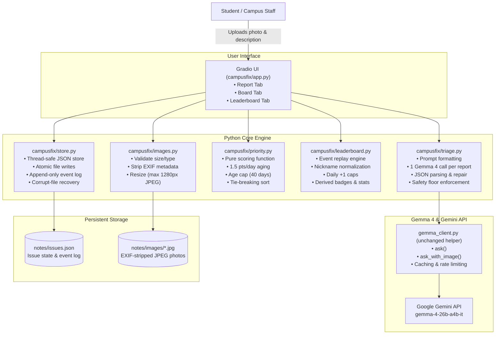

# CampusFix Architecture

CampusFix is a shared campus issue tracker and community participation leaderboard designed for MLH Hack Day: Gemma 4 through the Gemini API.

It operates on a clean separation of concerns:
> **Gemma 4 judges meaning; Python performs ranking, aging, validation, safety rules, event logging, storage, and points computation.**

---

## Architecture Diagram

---

## Key Principles & Data Flow

### 1. Exactly One Gemma 4 Call per Report Submission
- When a user submits an issue on the **Report a Problem** tab:
  1. `images.save_clean_image()` validates the image, strips all EXIF metadata, resizes the longest dimension to at most 1280px, and saves a fresh JPEG.
  2. `triage.triage()` issues **one single call** to `gemma_client.ask_with_image()` (or `ask()` if text-only) using model `gemma-4-26b-a4b-it`.
  3. `triage.parse_triage()` extracts and validates the JSON classification (category, severity, safety risk, location hint, reason).
  4. `triage.apply_safety_floor()` enforces deterministic rules: code can **only raise severity, never lower it**, ensuring hazardous keywords (such as sparking wires, smoke, gas leaks) always end up `critical` or `high` regardless of user text or injection attempts.
  5. `store.add_issue()` saves the issue record into `notes/issues.json` with an initial `created` event in its log.
  6. The Board, +1 confirmations, resolves, reopens, leaderboard recalculations, and campus statistics make **zero Gemma calls**.

### 2. Fair Priority Scoring & Aging
The priority score determines the board rank so neglected issues naturally rise above newer issues:
$$\text{Priority Score} = \text{Severity Base} + \min(\text{Age in Days}, 40) \times 1.5 + \min(\text{Confirmations} \times 2, 10)$$

- Severity bases: `critical` = 100, `high` = 60, `medium` = 30, `low` = 10.
- A low-severity issue neglected for 40+ days reaches a score of $10 + 60 = 70$, ranking higher than a brand-new high-severity issue ($60$).
- Tie-breaking: sorted by score descending, then original `created_at` timestamp ascending (older items first).

### 3. Event-Sourced Leaderboard Replay
Instead of maintaining a separate mutable database table of points, the leaderboard is computed on-the-fly by replaying the immutable `log` of each issue:
- **`created`:** 10 points (+3 bonus if report includes both photo and text). Flagged or anonymous reports earn 0.
- **`me_too`:** +2 points to the confirmer (capped at 20 points per day), +1 point to the original reporter (capped at 5 points per issue). Self "+1"s earn 0.
- **`resolved`:** 15 points (+1 bonus per 7 days of issue age, max +5) for fixing someone else's issue; 5 points for fixing own issue. Note must be at least 10 characters.
- **`reopened`:** If an issue is reopened, the points awarded to the resolver are removed. A subsequent resolver earns the resolve points upon legitimate fix.

### 4. Concurrency & Fault Tolerance
- **Atomic File Writes:** `store.py` writes to `issues.json.tmp` before calling `os.replace`, preventing half-written states.
- **Thread Safety:** Every read-modify-write cycle is protected by a module-level `threading.Lock`.
- **Corrupt File Recovery:** If `issues.json` is corrupted, it is automatically backed up as `issues.corrupt.<timestamp>.json` and a fresh store is initialized without crashing.
- **Offline / Wi-Fi Resilience:** If the Gemini API call fails, fallback triage assigns category `Other`, severity `medium`, and flags `needs_review=True`, allowing the campus app to continue functioning gracefully.

---

## File Map

| File | Purpose |
|---|---|
| `campusfix/app.py` | Gradio interface (Report, Board, Leaderboard tabs, and shared nickname bar). |
| `campusfix/config.py` | Categories, severities, scoring weights, points table, and environment overrides. |
| `campusfix/images.py` | File validation, EXIF stripping, LANCZOS resizing, and clean JPEG storage. |
| `campusfix/triage.py` | Classification prompt (`TRIAGE_RULE`), one Gemma call, JSON parser, and safety floor. |
| `campusfix/priority.py` | Pure priority score math, age labels, and deterministic board ranking. |
| `campusfix/leaderboard.py` | Event replay points engine, nickname sanitization, badges, and campus stats. |
| `campusfix/store.py` | Thread-safe atomic JSON store, event logging, +1 guards, resolve, and reopen. |
| `harness/tools.py` | Read-only campus tools (`list_top_issues`, `count_by_category`, `find_issues`). |
| `gemma_client.py` | Unchanged starter helper for Google Gemini API (`gemma-4-26b-a4b-it`). |
